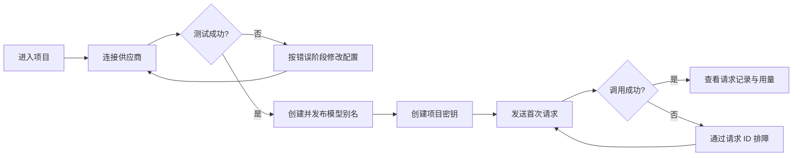
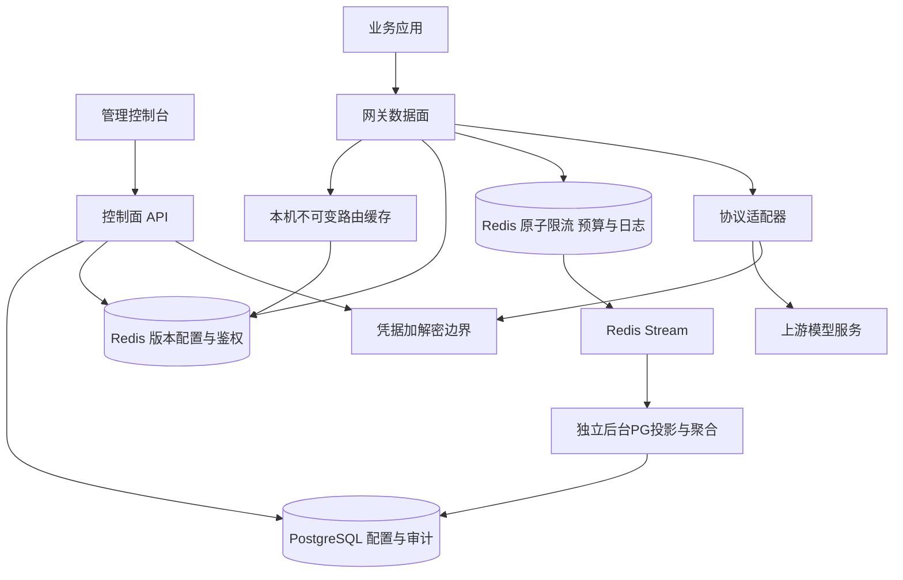

# AI Gateway 产品与系统设计

版本：v0.4 · 日期：2026-11-07 · 状态：已实现原型，Redis热路径与异步PG投影，PR #17待合并

## 1. 背景与设计依据

本方案对应 [jihuayu/ai-gateway](https://github.com/jihuayu/ai-gateway)。最初设计基于仅含LICENSE的 `6cd7649`；目前已实现原型，并按用户新增的热路径要求更新。体验研究假设与实际实现/验收证据分别标明。

默认定位：面向独立开发者和小型研发团队的 AI 网关，统一接入多个模型服务，提供 API Key 管理、模型路由、调用排障和用量统计。交付形态为桌面优先的 Web 管理控制台与独立网关 API。产品文案默认中文，代码、模型名及接口字段保留英文。

当前已交付可运行应用。用户新增“请求热路径不操作数据库”的约束后，默认数据面改为本机路由缓存、Redis鉴权/限流/计费和Stream日志，PG异步落库。最新协议以 [Redis热路径设计](hot-path.md) 为准；体验研究指标仍是未经过用户研究证明的目标。

## 2. 用户、问题与目标

| 用户 | 当前问题（设计假设） | 产品要帮助完成的任务 |
| --- | --- | --- |
| 应用开发者 | 不同模型接入方式分散，更换服务需要改业务代码 | 使用统一地址与项目密钥调用模型 |
| 项目负责人 | 用量分散，难以知道哪个项目产生费用 | 按项目、模型、密钥追踪用量并设置上限 |
| 维护者 | 调用失败后难以分辨参数、配额或上游故障 | 通过请求 ID 找到失败阶段和可执行的修复建议 |

核心闭环：连接一个供应商 → 创建模型别名 → 创建项目密钥 → 完成首次调用 → 在控制台核对结果。

首版体验目标：具备供应商凭据的用户能够在引导下于 10 分钟内完成首次调用。该数字是待验证的设计目标，不是现有表现。

建议验收指标：新手任务测试中至少 4/5 用户独立完成首次调用；排障任务中至少 4/5 用户在 2 分钟内定位预设的鉴权或限流错误。统计请求数、错误率与延迟时必须注明时间范围和数据更新时间。

## 3. 范围与优先级

### P0：形成完整可用闭环

- 单工作空间部署，允许创建多个项目；用户由管理员邀请，支持管理员、开发者、只读者三种角色。
- 管理供应商连接：名称、协议类型、服务地址、凭据、连通性测试、启停状态。
- 首个适配器支持经过验证的 OpenAI Chat Completions 协议子集；多个相同协议的服务也可分别配置。不把“兼容”视为全部参数与模型自动可用。
- 模型目录与项目级别名：例如 `support-chat` 映射到一个主目标及一个可选备用目标。
- 项目 API Key：创建、一次性展示、过期时间、模型范围、禁用、轮换。
- 支持文本聊天请求与 SSE 流式返回；明确校验支持的参数。
- 项目和密钥级请求限流、并发限制；配置项目月度估算费用上限。
- 请求列表、单次请求详情、按项目和模型聚合的用量统计。
- 提供可复制的接入示例，以及不保存对话的最小请求测试面板。

### P1：在闭环稳定后扩展

- 原生供应商协议适配、工具调用、结构化输出、嵌入与多模态；每项分别声明能力并做契约测试。
- 更丰富的告警、用量导出、团队管理、路由权重和配置版本回滚。
- 高级密钥策略与外部身份提供方集成。

### 暂不纳入首版

开放注册的多租户 SaaS、充值与代收账单、模型交易市场、复杂工作流编排、保存聊天历史的聊天产品、语义缓存和内容审核引擎。费用展示为估算，不作为财务结算依据。

## 4. 信息架构与页面设计

采用固定左侧导航和顶部项目切换器。项目范围页面始终展示当前项目；供应商、成员等全局页面展示“工作空间”，避免作用范围含混。时间筛选和列表筛选保存在 URL，便于返回和分享。

| 页面 | 主要内容 | 首要操作 | 关键状态 |
| --- | --- | --- | --- |
| 概览 | 首次接入步骤、请求数、成功率、首 token 延迟、估算费用、最近异常 | 完成下一项接入步骤 / 查看异常 | 尚未配置、暂无流量、正常、数据延迟 |
| 模型与路由 | 别名、主目标、备用目标、能力、发布版本 | 新建别名 | 草稿、可用、禁用、配置失效 |
| 供应商 | 服务地址、协议、最近测试时间与结果、所用模型 | 添加连接 | 未测试、测试成功、鉴权失败、超时、禁用 |
| API Keys | 名称、前缀、权限、过期时间、最近使用 | 创建密钥 | 有效、即将到期、禁用、已过期 |
| 请求日志 | 时间、请求 ID、模型别名、状态、耗时、token、估算费用 | 查看请求详情 | 加载、空结果、部分数据、查询失败 |
| 用量 | 趋势、按模型/密钥分组、预算使用、未计价请求 | 查看明细 / 设置预算 | 无数据、正常、临近上限、达到上限 |
| 接入指南 | 网关地址、可用模型、curl 示例、测试入口 | 复制示例 / 发送测试 | 无可用模型、就绪、请求中、成功、失败 |
| 设置 | 项目名称、成员权限、保留期限、审计记录 | 保存设置 | 未保存、保存中、保存成功、版本冲突 |

### 4.1 概览布局示意

以下是结构线框，不代表最终像素级视觉稿。

```text
┌──────────────┬─────────────────────────────────────────────────────┐
│ AI Gateway   │ 项目：客服助手 ▾                最近 24 小时 ▾      │
│              ├─────────────────────────────────────────────────────┤
│ 概览         │ 概览                            数据更新于 10:32    │
│ 模型与路由   │ [请求数] [成功率] [P95 首 token 延迟] [估算费用]    │
│ 供应商       │                                                     │
│ API Keys     │ 请求量与错误趋势                预算使用情况        │
│ 请求日志     │ [带图例的趋势图]                [金额 / 上限]       │
│ 用量         │                                                     │
│ 接入指南     │ 最近异常                            查看全部 →     │
│              │ 时间     模型      失败原因            请求 ID      │
│ 设置         │ 10:30    support   上游限流            req_…        │
└──────────────┴─────────────────────────────────────────────────────┘
```

尚未接入时，顶部替换为三步清单：“连接供应商 → 配置模型 → 创建密钥并验证”。完成任一步后可中断并返回，已完成项保持记录。没有请求时展示“尚无调用记录，发送一次测试请求”，不显示虚假的零延迟或 100% 成功率。

### 4.2 供应商连接与模型路由

添加连接使用独立表单页，先选择协议，再填名称、地址和密钥。默认提供已知服务地址，自定义地址需通过服务端地址校验。密钥输入默认隐藏，保存后只能替换，不能读回。

“保存草稿”和“测试连接”分离。测试可能产生供应商费用，按钮旁明确说明。测试结果给出阶段、时间和安全的错误说明，不展示上游原始敏感响应。最近测试通过不等于持续健康。

新建模型别名时选择实际模型与支持能力。路由编辑页面同时显示当前生效版本和草稿，发布前展示变更摘要。已有请求固定使用开始时的配置版本；新请求使用新版本。

备用目标必须覆盖该别名声明的能力。目标模型的价格、输出风格和数据处理地区可能不同，配置备用时在同一页面展示这些差异。无适合目标时禁止发布，不在请求执行时悄悄删除参数。

### 4.3 API Key 与请求详情

创建密钥只要求名称、允许使用的模型、有效期；默认只授权当前项目，默认有效期 30 天，可调整。完整密钥只展示一次，复制成功有反馈，关闭前提示保存。列表只显示前缀。浏览器页面的示例代码始终使用环境变量占位符，真实 key 不写入 URL 或持久化到浏览器存储。

轮换流程为“创建替代密钥 → 更新应用配置 → 检查新密钥已有调用 → 禁用旧密钥”。禁用确认弹窗写明影响：阻止后续请求，已发出的请求不会因此保证停止。

请求详情采用“摘要 + 尝试时间线”：展示网关请求 ID、项目、密钥前缀、别名、实际目标、路由版本、最终状态、延迟和用量；每次上游尝试分别记录原因与耗时。默认不显示或存储提示词、回答和鉴权头。

### 4.4 通用交互与视觉规则

- 采用浅色中性背景、白色内容面板、蓝色主操作；成功、警告、错误同时使用图标和文字，不只靠颜色。
- 建议 token：背景 `#F8FAFC`、正文 `#0F172A`、次要文字 `#475569`、主色 `#1D4ED8`、错误 `#B91C1C`。落地时逐项验证对比度，不能仅凭色值声明符合无障碍标准。
- 正文字号 14–16px，页标题 24px，使用 4/8/12/16/24/32px 间距；代码与密钥前缀使用等宽字体。
- 桌面侧栏建议宽 224px，内容区按 24px 留白。小于 768px 时导航收为抽屉，指标卡变为两列或单列，表格优先保留模型、状态和时间，详情进入独立页面。
- 表单错误显示在字段下方并保留已填内容；提交中禁止重复提交；查询失败保留旧数据并标注其更新时间。
- 所有交互可使用键盘，焦点清晰，弹窗有焦点管理；图表附带表格摘要。普通文字对比度目标为 WCAG AA 4.5:1，触控目标建议至少 44px。
- 文案使用“连接超时，请检查服务地址并重试”等可执行描述。不要只显示“出错了”或未经处理的堆栈。

## 5. 核心流程与异常处理



| 场景 | 对外行为 | 控制台反馈与恢复 |
| --- | --- | --- |
| key 无效、过期或禁用 | 401，统一鉴权错误，不枚举项目 | 提示检查密钥状态，允许创建替代 key |
| key 无权使用模型 | 403，不调用上游 | 展示所需模型权限 |
| 模型不存在 / 参数不支持 | 404 / 400，不调用上游 | 指向可用模型或支持的参数 |
| 请求频率、并发或预算达到上限 | 429，稳定的错误码 | 分别显示恢复时间或调整入口；仅可计算时提供 Retry-After |
| 上游限流或暂时不可用 | 满足安全条件时尝试备用，否则返回 429/502/503 | 显示每次尝试，区分网关与上游限流 |
| 达到整体超时 | 非流式返回 504 | 展示失败阶段与总耗时 |
| 已返回流式内容后失败 | 发送可解析的 SSE error 事件后关闭；HTTP 状态无法再更改 | 标记为“部分响应”，不记作完整成功 |
| 客户端取消 | 尽力取消上游并释放并发配额 | 标记取消，费用按已观察到的用量估算 |
| 用量信息缺失 | 正常返回可用结果 | 用量标记未知，不当作 0 |

## 6. 系统结构与技术建议

首版采用模块化单体，控制面和数据面保持模块边界，减少初期部署复杂度；后续根据流量与可用性需求拆分。



实现使用Node.js/TypeScript/Fastify与原生Web控制台。PG保存配置和异步账本，Redis执行实时鉴权、限流、计费与日志；Kafka保留为可选后续事件通道。请求不等待PG，不在缓存缺失时回查PG。详细职责与边界见 [模块实施设计](implementation.md) 和 [Redis热路径设计](hot-path.md)。

控制面使用会话认证，数据面使用项目 key；两者权限域分离。浏览器不直接持有供应商密钥。数据面不得依赖每次访问控制台服务才能转发请求，但密钥禁用和配置更新需具有明确传播边界：P0 key 状态检查访问权威状态存储；发生存储故障时拒绝新请求，而不是继续使用过期授权。

### 6.1 请求生命周期

1. 分配请求 ID，限制请求体大小，解析并校验协议与字段。
2. 从Redis验证key、项目和模型权限，取得本机或Redis路由快照。
3. Redis原子检查版本、速率、并发、预算和日志容量，写预留及派发日志；失败时不请求上游。
4. 选择主目标，解密所需凭据，调用适配器；设置连接、首包、空闲与整体超时。
5. 非流式结果统一映射字段；流式逐块透传并遵守背压，不累计完整回答后再发送。
6. 完成、取消或失败时在Redis记录安全元数据、释放配额并结算预算；后台按epoch/revision幂等写PG账本，提交后确认日志。

建议初始参数：连接超时 5 秒、首包超时 30 秒、流式空闲超时 30 秒、整体上限 120 秒；均可由管理员配置并受服务器上限约束。这些参数需在真实模型测试后调整。

### 6.2 路由、重试与费用语义

采用显式优先级，主目标失败后最多进行一次备用尝试，总尝试数不超过 2，共享同一个整体超时。参数校验失败、鉴权错误、权限错误不自动重试。

默认只对可明确判断请求未被发送的连接故障，或上游明确拒绝执行的限流响应进行备用；不把所有 5xx、读取超时都视作可安全重试。后者可能已经执行和收费，首版直接报错并在日志注明执行状态未知。

一旦向客户端输出首个内容片段，不切换目标、不自动续写。每个 attempt 单独计算费用，顶层请求费用为所有可计价尝试之和。即使未向客户端返回内容，也不能保证上游完全没有计费。

预算以月度UTC周期统计；客户端必须指定输出上限或使用网关强制默认上限。开始前按保守输入估算和最大输出费用原子预留，完成后用实际usage结算。usage缺失时保留保守估算。PG异步账本可能滞后，Redis状态/日志丢失时不能直接从PG归零重建；须验证完整持久化来源并隔离旧写入者。Redis日志或预算操作失败时拒绝新准入，有界容量保护已接收请求终结。

“硬上限”指网关估算口径内的准入上限，不保证与供应商账单绝对一致。未配置价格的模型不能启用预算控制，界面要求补齐价格或明确关闭该控制。不能以未知价格按零费用放行。

## 7. 数据模型与接口边界

以下是逻辑模型，具体字段约束与迁移需在实现阶段设计。

| 实体 | 关键字段与约束 |
| --- | --- |
| Workspace / Membership | 工作空间、用户、角色；成员关系唯一 |
| Project | 工作空间、名称、状态、月预算、统计时区 |
| ProviderConnection | 工作空间、协议、地址、加密凭据、状态、测试时间 |
| ModelTarget | 连接、上游模型标识、能力、输入/输出单价及生效时间 |
| ModelAlias / RouteVersion | 项目、别名、主备目标、版本、发布状态；项目内别名唯一，版本不可变 |
| ApiKey | 项目、公开前缀、不可逆摘要、模型权限、过期时间、禁用时间 |
| Request / Attempt | 请求 ID、项目、key ID、路由版本、状态、耗时、错误码、目标与用量；不含正文 |
| BudgetReservation / UsageLedger | 项目、周期、请求/尝试 ID、预留/结算金额、计价快照、估算状态、幂等事件 ID |
| AuditEvent | 操作者、时间、对象、动作、变更摘要；敏感字段脱敏 |

所有项目资源查询必须绑定所属工作空间与项目权限，不能仅凭资源 ID 授权。删除连接前检查路由引用；已被调用记录引用的模型、路由与 key 采用归档或禁用，保留审计关联。

数据面提供 `GET /v1/models` 与 `POST /v1/chat/completions`。首版支持 `model`、文本 `messages`、`stream`、`temperature`、`max_tokens`；模型不支持的字段返回明确的 400，而非静默忽略。具体消息角色与参数范围由适配器能力表约束。

控制面使用 `/api/projects`、`/api/providers`、`/api/aliases`、`/api/keys`、`/api/requests`、`/api/usage` 等资源。写入动作有角色检查和审计；列表采用游标分页，默认 50 条、上限 100 条。路由发布使用版本号防止并发覆盖。

错误响应形态示例：

```json
{
  "error": {
    "code": "rate_limit_exceeded",
    "message": "请求频率已达到项目上限，请稍后重试。",
    "type": "gateway_error"
  },
  "request_id": "req_example"
}
```

非流式和流式请求均通过响应头 `x-request-id` 暴露关联 ID。SSE 的完成、错误和取消行为必须在接入指南中给出真实示例，客户端不可把连接关闭等同于成功完成。

## 8. 权限、凭据与数据保护

| 操作 | 管理员 | 开发者 | 只读者 |
| --- | --- | --- | --- |
| 查看有权限项目的指标与请求元数据 | 是 | 是 | 是 |
| 创建本人项目 key、禁用本人 key | 是 | 是 | 否 |
| 发送测试请求 | 是 | 是 | 否 |
| 发布路由、管理供应商与全部 key | 是 | 否 | 否 |
| 调整预算、管理成员与保留策略 | 是 | 否 | 否 |

开发者不能创建超出本人项目和模型范围的 key。测试请求使用与生产调用一致的计量和限流路径，归属当前用户与项目，不成为权限或预算旁路。

网关 key 使用高熵随机值，只存摘要；供应商凭据使用服务端加密，解密密钥与业务数据库分离。控制面会话采用安全 cookie，写请求校验 CSRF；退出、权限变更和管理员禁用应能使会话失效。

供应商自定义地址仅管理员可配置，默认要求 HTTPS，并在解析 DNS、连接及重定向时校验目标地址，阻止环回、私网和元数据地址；确有内网部署需要时使用部署级显式允许名单。不得允许请求参数任意指定代理目标或转发任意鉴权头。

默认不采集提示词和回答；URL、错误体、header、查询条件中的敏感值统一过滤。请求元数据建议保留 30 天，用量汇总保留 12 个月；上线前确认实际需求，配置定期清理并验证备份恢复和保留边界。

## 9. 观测、性能与可靠性

成功率分母为已鉴权并进入执行阶段的请求，成功须为完整响应；同时单列鉴权失败、拒绝准入、取消、部分响应和上游失败，避免用口径隐藏错误。分别统计整体耗时、首 token 延迟及上游尝试耗时。

控制台显示请求数、token、估算费用和未知用量请求数。统计更新时间目标为 60 秒内；超时显示“数据更新延迟”，不继续冒充实时结果。

工程目标（需压测，不代表已达标）：在 2 vCPU / 4 GB、100 个并发请求、同区数据存储、模拟上游条件下，鉴权、路由和限流新增处理耗时 P95 不超过 50ms；流式代理新增块转发耗时 P95 不超过 20ms。测试报告须记录请求体大小、响应速率、持续时间及资源用量。

部署支持优雅关闭：停止接收新请求，给活跃流留出排空时间，到期取消并标记未完成。配置变更、密钥禁用、预算结算、进程重启均应有可观测事件。业务请求正文不进入指标标签或追踪属性。

## 10. 验收清单

| 编号 | 场景 | 通过条件 |
| --- | --- | --- |
| A01 | 全新工作空间首次接入 | 完成连接、发布别名、创建 key、发送请求并在日志和用量页找到记录 |
| A02 | 非法 key / 跨项目资源访问 | 返回 401/403 或不泄露存在性的 404，且没有上游调用 |
| A03 | 过期、禁用与轮换 key | 后续请求立即受权威状态约束；旧 key 禁用不影响新 key |
| A04 | 主目标连接失败 | 满足安全重试条件时仅尝试一次备用，日志关联同一请求 ID |
| A05 | 上游已开始返回后断流 | 保留已返回片段、发送错误并标记部分响应，不触发备用 |
| A06 | 多请求争抢配额 | 在并发测试中预算预留与并发计数无重复放行，结束后无计数泄漏 |
| A07 | usage 缺失或价格未知 | 展示未知/估算状态，不能被计作免费调用 |
| A08 | 重复计量事件与异常重启 | 同一事件不重复结算，恢复后预留可对账，未恢复前不绕过限制 |
| A09 | 自定义地址与日志脱敏 | SSRF 用例被拒绝；凭据、请求正文和回答不出现在日志与错误中 |
| A10 | 键盘和窄屏操作 | 可完成创建 key 与查看请求，焦点可见，核心操作不溢出视口 |
| A11 | 并发编辑路由 | 旧版本保存返回冲突，已开始请求保持原配置，新请求获得新版本 |
| A12 | 上游超时、取消与慢客户端 | 时间限制生效，上游尽力取消，背压有效且内存不随回答总长无限增长 |

## 11. 实施顺序与交付门槛

1. **协议验证**：确定首个真实上游，验证非流式、SSE、usage 与错误映射，形成能力表。未通过前不宣称通用兼容。
2. **最小贯通**：搭建项目、连接、别名、key 和单目标调用，交付接入指南；通过 A01–A03。
3. **控制台与排障**：实现概览、请求详情、用量和三步引导；验证关键页面空态、错误态与 A10。
4. **生产约束**：补齐预算、限流、备用、审计、保留策略和故障恢复；通过其余验收项与压测。
5. **试用评审**：用真实新用户执行第 2 节任务测试；修复高优先级问题后决定 P1 顺序。

阶段不预设工期；首个适配器的流式语义、计费精度与运行环境验证后再估算。每阶段输出可演示闭环、测试证据和剩余限制。

## 12. 待收敛假设与决策记录

| 问题 | 本版默认 | 影响 |
| --- | --- | --- |
| 目标产品是否确为 AI 网关？ | 根据仓库名称设计 | 如目标不同，需重写定位与范围 |
| 主要用户是谁？ | 独立开发者与小型研发团队 | 决定组织、权限与引导复杂度 |
| 部署与租户模式？ | 单工作空间、管理员邀请、自托管优先 | 开放 SaaS 需要额外租户隔离与运营方案 |
| 第一批上游有哪些？ | 一个经过验证的 Chat Completions 协议服务 | 决定适配器和能力验收范围 |
| 是否以费用结算为核心？ | 仅估算、预算控制，不收款 | 实际结算需要财务账本与对账设计 |
| 业务必需能力？ | 文本聊天与流式输出 | 工具调用、图片、嵌入需独立扩展 |
| 品牌和视觉偏好？ | 简洁、浅色、数据密度适中的管理控制台 | 后续视觉稿与组件规范依据 |

本版关键取舍：先解决接入、授权、可观测与可控用量，再扩展协议与运营功能；用不可变路由版本和逐次尝试记录解释网关行为；在信息未知时明确显示未知，避免把估算当事实。
