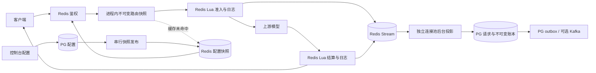

# Redis 热路径与异步 PostgreSQL 账本

日期：2026-11-07（UTC）。目标 [#23](https://github.com/jihuayu/ai-gateway/issues/23)，任务 #24–#27。本文取代早期设计中“每请求查询PG、先提交PG再派发/释放预留”的协议。默认 `buildApp` 已切换到本协议；旧PG适配器仅保留作兼容性测试，不提供生产回退开关。

## 请求与控制面的边界

`/v1/models` 和 `/v1/chat/completions` 的鉴权、路由、准入、派发标记、心跳、attempt元数据及结算不调用PG，也不借用PG连接。路由缓存未命中只从Redis取快照，缺失则返回503。接口依赖必须显式提供数据面，转发处理器没有隐式PG回退。

PG仍用于启动迁移/配置发布、控制台登录与配置、查询统计和后台投影。**预热后的PG故障不立即停止网关调用**；启动和控制台写入仍需要PG。该部署同时包含控制面，并不承诺在PG故障时从零启动控制台。

## 配置与密钥撤销

配置发布读取PG的一致快照，按数据库锁串行发布。内容摘要作为版本，Redis原子替换鉴权索引并保存不可变路由快照。配置变更只有在Redis发布成功后才返回成功；发布失败时PG可能已经提交，响应为失败，后台重试发布。不能把失败响应当作配置已经全局生效。

每次鉴权读取Redis密钥状态和当前版本，不缓存授权。路由可在本机缓存4个版本，快照在Redis保留24小时并持续刷新当前版本。准入Lua再次核对配置版本与到期时间。发布成功后，各实例的新准入受新配置约束；已获准的在途请求继续使用其冻结的路由与价格。

控制台临时测试密钥也先发布到Redis，测试结束撤销后再次发布。控制台身份和数据面API Key的权限域保持分离。

## Redis 财务状态和日志

Redis成为实时限额与未落库事件的持久状态，PG保存异步的审计账本。单个Lua命令同时更新预算/租约/状态并追加完整安全快照到Stream，调用方等待该Redis命令完成。没有先在进程内排队再返回成功的计费写入。

费用保持整数微美元，Lua与JS限制到2^53−1。Lua使用精确整数JSON编码，避免默认CJSON数值精度截断。每次请求冻结UTC周期、价格、路由；预留覆盖所有允许的尝试。取消不返还频率token；只有未派发请求可释放预留。过期派发请求按预留额记未知费用，保留一次actual更正的容量；第一个实际金额最终化，同值幂等、不同值409。

新准入需为最多7个日志事件预留容量。每次写事件消耗一个预留名额，终结时释放余量；未知费用保留一个未来更正名额。因此达到积压上限后会拒绝新请求，已接收请求仍有结算空间。心跳不生成重复财务事件。默认容量10000，既包括未投影Stream记录，也包括已预留的未来事件。

同一部署的状态、日志、配置共用一个Redis hash slot，以保证原子性。**V1不是跨Redis分片的水平扩展方案**；热点及部署整体吞吐需要实测。应用可运行多个实例，共享同一财务命名空间。

## 异步投影与重放

`HotStream`使用consumer group、pending重试和XAUTOCLAIM接管中断的消费者。`HotProjector`在独立的4连接池工作；控制面主池最多12连接，单个应用实例合计最多16，额外worker最多4。部署总量须按实例数预算连接。

每条日志是无正文的完整请求快照，包含epoch和单请求递增revision。一个批次可合并同一请求的旧快照。PG事务内写请求、预留、attempt、不可变账本、outbox与revision墓碑，提交后才XACK并XDEL。PG失败、解析失败或事务回滚时保留未确认消息，不将财务事件丢入DLQ后直接确认。

旧/重复revision不回退状态。终结快照可以先于准入快照到达；未知费用更正生成补偿分录，历史分录不改写。墓碑独立于请求保留清理，防止旧消息复活已清理记录。墓碑未来归档必须先制定覆盖全部允许重放窗口的协议。

现有PG outbox后仍可使用Kafka传输用量/审计事件。本轮采用**Redis Stream→异步PG**实现数据库解耦，没有声称计费请求直接同步写Kafka。Kafka中断导致PG outbox积压时，后台把准入暂停状态发布到Redis；请求不会查询PG积压。达到上限后仍允许已准入请求终结。

查询统计和请求详情允许短暂滞后；控制台预算读取Redis当前值，并显示统计同步状态，不用滞后PG预算覆盖实时准入状态。

## 耐久性和故障边界

默认要求Redis `appendonly=yes`、`appendfsync=always`、`maxmemory-policy=noeviction`，启动会检查。Redis访问仍有网络和持久化成本，不能将其描述为零成本或全内存。`HOT_DURABILITY=memory`仅用于开发/测试，生产配置拒绝此选项；纯内存不能保证整组Redis丢失后零丢计费事件。

Lua检查实际Redis run_id、epoch、项目状态和Stream尾游标。身份变化、预算状态丢失或日志被删除后重建会拒绝准入。PG manifest持久记录财务命名空间；一个PG schema只允许一个owner，不能靠修改命名空间从滞后的PG创建新预算。

Redis重启或副本提升后，当前实现**不会自动重新绑定run_id，也不会只从PG重建后直接放行**。必须先停止旧写入者并隔离旧主，确认完整AOF/日志连续性、排空待投影事件、核对PG与实时预算/未终结请求，再进行受控恢复。仅有滞后PG备份不足以证明没有未落库费用；无法确认时保持关闭，按保守未知费用处理。不要删除manifest、修改命名空间或手工归零预算来绕过保护。

首次从旧版迁移须排空旧版请求、停止旧版写入者，才允许一次性导入已同步PG账本。新旧计费路径不得同时处理同一项目流量。PG恢复演练需同时保留匹配的Redis AOF、Stream和部署加密密钥，先在隔离环境核对，不覆盖在线数据。

## 验证

`test/hot-path.test.ts`覆盖两个连接池禁止SQL下的请求/SSE/备用/断流、真实PG TCP断连与恢复补账、跨实例配置与撤销、积压容量、事务回滚、重复/乱序/保留后重放、未知费用更正、整数精度、过期租约、状态/日志丢失及命名空间保护。`test/hot-stream.test.ts`覆盖pending重试、接管、未交付消息不能删除和非法消息保留。

压测脚本分别统计HTTP响应、Redis结算与完整PG投影，SQL参数、密钥和正文不进入报告。原50ms处理/20ms块转发目标仍需固定资源与上游基线验证，零SQL本身不是生产SLO认证。具体数字及独立DeepSeek审阅记录随本轮验收报告更新。
